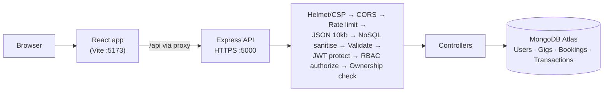

# HustleHub+ — Part 2: Secure Stack

## What this system is

HustleHub+ is a freelance marketplace built on the MERN stack. Freelancers advertise services ("gigs"), clients browse and book them, and every booking produces a transaction record and updates the freelancer's tracked income.

Part 1 delivered the secure backend foundation (registration, login, JWT, hashing, validation). **Part 2 extends it into a full-stack application** with gig management, bookings, simulated payments, transaction records, a React frontend, role-based access control, and expanded automated testing.

## Features

### Clients
- Register and log in
- Browse all available gigs
- Book a gig (simulated payment — confirmation is immediate)
- View their own bookings and transaction history

### Freelancers
- Register and log in
- Create, edit and delete **their own** gigs
- View bookings received on their gigs
- View total income earned and number of bookings

### Platform
- Every booking creates a **Booking** and a **Transaction** record linked to both the client and the freelancer, and increments the freelancer's income — all inside a single MongoDB transaction, so they succeed or fail together
- Users can never view, modify or delete data that does not belong to them

## Tech stack

| Layer | Technology |
|---|---|
| Frontend | React 19, Vite, React Router, Axios |
| Backend | Node.js, Express 5 |
| Database | MongoDB Atlas, Mongoose |
| Auth | JWT (1h expiry), bcrypt (cost 12) |
| Security | Helmet (CSP), CORS whitelist, express-validator, sanitize-html, express-rate-limit, custom NoSQL sanitiser |
| Testing | Postman + Newman (API), Vitest + React Testing Library (frontend) |
| Transport | HTTPS via locally generated self-signed certificate |

## Architecture

Full diagram with trust boundaries: [`docs/architecture.md`](docs/architecture.md)



## Project structure

```
hustlehub-plus/
├── backend/
│   └── src/
│       ├── config/db.js
│       ├── controllers/   auth · gig · booking · transaction
│       ├── middleware/    auth (JWT) · role (RBAC) · validate · rateLimit · sanitize
│       ├── models/        User · Gig · Booking · Transaction
│       ├── routes/        auth · gig · booking · transaction
│       ├── utils/token.js
│       └── server.js
├── frontend/
│   └── src/
│       ├── api.js                 # axios instance + JWT interceptor
│       ├── context/AuthContext.jsx
│       ├── components/            Navbar · ProtectedRoute · GigCard (+ test)
│       └── pages/                 Login (+ test) · Register · Gigs · GigForm ·
│                                  ClientDashboard · FreelancerDashboard
├── postman/HustleHub.postman_collection.json
└── docs/
```

## API endpoints

| Method | Endpoint | Access | Description |
|---|---|---|---|
| GET | `/api/health` | Public | Liveness check |
| POST | `/api/auth/register` | Public (rate limited) | Register as `client` or `freelancer` |
| POST | `/api/auth/login` | Public (rate limited) | Returns a JWT |
| GET | `/api/auth/me` | Any logged-in user | Own profile |
| GET | `/api/gigs` | Public | Browse all gigs |
| GET | `/api/gigs/:id` | Public | Single gig |
| GET | `/api/gigs/mine` | Freelancer | Own gigs |
| POST | `/api/gigs` | Freelancer | Create gig |
| PUT | `/api/gigs/:id` | Freelancer **and owner** | Update gig |
| DELETE | `/api/gigs/:id` | Freelancer **and owner** | Delete gig |
| POST | `/api/bookings` | Client (rate limited) | Book a gig → booking + transaction + income update |
| GET | `/api/bookings/mine` | Client | Bookings the client made |
| GET | `/api/bookings/freelancer` | Freelancer | Bookings on the freelancer's gigs |
| GET | `/api/transactions/mine` | Client or freelancer | Only transactions the user is part of |
| GET | `/api/transactions/income` | Freelancer | Total income + booking count |

## Security measures

### Authentication
- **Password hashing** — bcrypt, cost factor 12. Only `passwordHash` is stored and it is never returned in any response.
- **JWT** — signed with a secret from `.env`, 1-hour expiry, carries only `{ id, role }`. Every protected route runs the `protect` middleware, which rejects missing, malformed, expired or tampered tokens with `401`. Because the token is signed, a user who edits their own role inside the token is rejected.
- **Anti-enumeration** — login returns the same `Invalid credentials` message for an unknown email and a wrong password; duplicate registration returns a generic `Registration failed`.

### Authorisation (RBAC)
- **Role middleware** — `authorize('freelancer')` / `authorize('client')` on every role-specific route returns `403` for the wrong role (e.g. clients cannot create gigs, freelancers cannot book).
- **No privilege escalation** — registration only accepts `client` or `freelancer`; requests with `role: "admin"` are rejected by validation and the controller whitelists the role as a second layer.
- **Ownership checks** — update/delete compare the gig's `freelancer` field with the JWT user id and return `403` otherwise. The owner is always taken from the token, never from the request body.
- **Data isolation** — bookings, transactions and income queries are always filtered by the logged-in user's id, so users only ever see their own records.
- **Minimal data exposure** — populated users return `name` only; emails and hashes are never sent to other users.

### Input validation and sanitisation
- **express-validator** on every body and URL parameter: email format, password length, price range (1–100 000), field lengths, valid MongoDB ObjectIds.
- **XSS** — gig text fields are passed through `sanitize-html` with no allowed tags, stripping `<script>`, `` etc. React's default output escaping is a second layer; `dangerouslySetInnerHTML` is never used.
- **NoSQL injection** — a custom middleware strips keys starting with `$` or containing `.` from request bodies (`express-mongo-sanitize` is incompatible with Express 5), and Mongoose `sanitizeFilter` is enabled as a second layer.
- **Payload size** — JSON bodies are limited to 10kb (`413` otherwise).

### Rate limiting (express-rate-limit)
| Limiter | Applied to | Limit |
|---|---|---|
| Login | `POST /api/auth/login` | 5 **failed** attempts / 15 min (configurable via `AUTH_RATE_LIMIT`) |
| Register | `POST /api/auth/register` | 20 / hour |
| Booking | `POST /api/bookings` | 10 / 10 min |
| Global | All routes | 300 / 15 min |

Exceeded limits return `429` with standard `RateLimit` headers.

### Security headers
- **Helmet** with an explicit **Content Security Policy** on the API: `default-src 'self'`, `script-src 'self'`, `object-src 'none'`, `frame-ancestors 'none'` (clickjacking), `base-uri 'self'`, `form-action 'self'`; plus `X-Content-Type-Options: nosniff`, HSTS, and `X-Powered-By` removed.
- The built frontend is served with its own CSP (configured in `vite.config.js` → `preview.headers`).
- **CORS** only allows the origin in `CLIENT_URL`.

### Error handling and transport
- A central error handler logs full errors server-side and always returns a generic message — no stack traces or internals reach the client.
- The frontend shows friendly messages only (e.g. "Invalid email or password", "Too many attempts") and never displays raw server errors or tokens.
- All API traffic is served over HTTPS.

### Data integrity
- Booking creation, transaction creation and the income increment run in a single **MongoDB transaction** (`session.withTransaction`), so income can never drift from the recorded transactions.

## Setup

### Prerequisites
- Node.js 18+
- `openssl` (ships with Git for Windows)
- A MongoDB Atlas cluster (**add your current IP under Atlas → Network Access**)

### 1. Backend

```bash
cd backend
npm install
```

Copy `.env.example` to `.env` and fill in real values:

```
PORT=5000
MONGO_URI=<your MongoDB connection string>
JWT_SECRET=<a long random string>
JWT_EXPIRES_IN=1h
NODE_ENV=development
CLIENT_URL=http://localhost:5173
AUTH_RATE_LIMIT=5
```

URL-encode special characters in the Atlas password (`@` → `%40`).

Generate the local SSL certificate (inside `backend/`):

```bash
mkdir certs && cd certs
openssl req -x509 -nodes -newkey rsa:2048 -keyout localhost-key.pem -out localhost.pem -days 365 -subj "/CN=localhost" -addext "subjectAltName=DNS:localhost,IP:127.0.0.1"
```

Start the API:

```bash
npm run dev
```

The API runs at `https://localhost:5000`.

### 2. Frontend

```bash
cd frontend
npm install
npm run dev
```

Open `http://localhost:5173`. The Vite dev server proxies `/api` to the HTTPS backend (accepting the self-signed cert), so no browser certificate prompt is needed.

To run the production build with the frontend CSP header:

```bash
npm run build
npm run preview
```

## Testing

### Backend — Postman + Newman

The collection at [`postman/HustleHub.postman_collection.json`](postman/HustleHub.postman_collection.json) contains **53 requests with assertions** across 9 folders:

| Folder | Covers |
|---|---|
| 0. Health & security headers | CSP, `nosniff`, hidden `X-Powered-By` |
| 1. Auth – Register | Valid registrations (unique email per run), duplicate, invalid email, short password, **admin self-assignment blocked** |
| 2. Auth – Login | Token capture for 3 users, wrong password and unknown email return the same message |
| 3. Protected route | No token, garbage token, **forged role claim** → 401 |
| 4. Gigs | CRUD, invalid input, client → 403, owner spoofing ignored, **non-owner update/delete → 403** |
| 5. Bookings & transactions | Booking → transaction linkage, amount = price, income tracking, freelancer → 403, **cross-user isolation** |
| 6. Security | XSS stripped, NoSQL operator injection → 400, >10kb payload → 413, generic 404 |
| 7. Cleanup | Owner deletes gig |
| 8. Rate limiting | Login brute force → 429, booking flood → 429 |

Run with Newman (API must be running):

```bash
cd backend
npm run test:api
```

This prints a CLI summary and writes an HTML report to `postman/reports/newman-report.html`.

> **Re-running:** the rate limiters store counters in memory and folder 8 deliberately exhausts them. Restart the API (type `rs` in the nodemon terminal) before each full run.

To use the Postman app instead: **Import** the collection, disable **Settings → General → SSL certificate verification**, and run it with the Collection Runner in order.

### Frontend — Vitest + React Testing Library

```bash
cd frontend
npm test
```

| Test file | Covers |
|---|---|
| `components/GigCard.test.jsx` | Renders title/price/freelancer; Book button hidden when user cannot book; clicking Book calls the handler with the gig id |
| `pages/LoginPage.test.jsx` | Renders fields; empty submit shows a validation error without calling the API; bad credentials show a generic error |

Lint:

```bash
npm run lint
```

## Demo walkthrough

The demonstration video follows this flow:

1. Register a freelancer and a client
2. Freelancer logs in → creates a gig → edits it
3. Client logs in → browses gigs → books the gig → sees the confirmation reference
4. Client dashboard → booking and transaction listed
5. Freelancer dashboard → booking received and income updated
6. Security: client cannot reach the freelancer dashboard; Postman shows 401 (no token), 403 (wrong role / not owner), 400 (injection), 429 (rate limit)
7. Newman run and frontend tests passing

## Known limitations

- Payments are simulated; no payment provider is integrated.
- The JWT is stored in `sessionStorage` (cleared when the tab closes). An httpOnly cookie would remove JavaScript access entirely but requires CSRF protection; the strict CSP and absence of `dangerouslySetInnerHTML` mitigate XSS token theft in the meantime.
- Rate-limit counters are in memory, so they reset on restart and are not shared across multiple server instances.
- No password reset or email verification flow.
- The admin role exists in the model but has no dedicated features yet.
