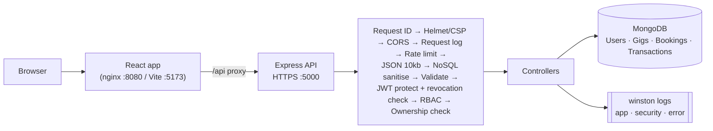
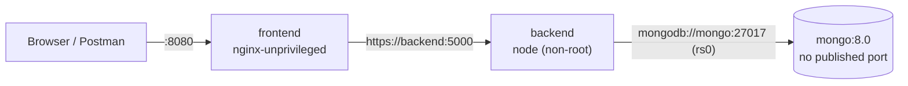
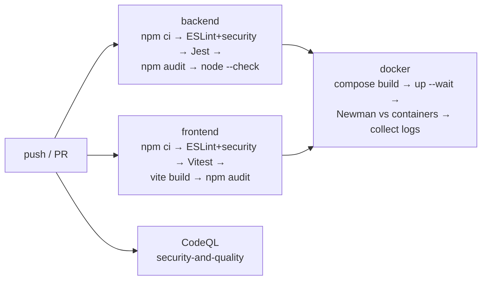

# HustleHub+ — Secure Freelance Marketplace (Final POE)

[](https://github.com/AndaSizaniZazu/hustlehub-plus/actions/workflows/ci.yml)

## What this system is

HustleHub+ is a freelance marketplace built on the MERN stack. Freelancers advertise services ("gigs"), clients browse and book them, and every booking produces a transaction record and updates the freelancer's tracked income. Currency is South African Rand (R).

- **Part 1** delivered the secure backend foundation: registration, login, JWT, hashing and validation.
- **Part 2** extended it into a full-stack app with gigs, bookings, simulated payments, transactions, a React frontend, RBAC and automated tests.
- **Part 3 (this release)** adds financial insights (SARS tax estimate and charts), a CI/CD pipeline with static analysis, Docker containerisation, structured logging, and two extra security features: account lockout and server-side logout.

## Contents

1. [Features](#features)
2. [Tech stack](#tech-stack)
3. [Architecture](#architecture)
4. [Project structure](#project-structure)
5. [Setup](#setup): local and Docker
6. [API endpoints](#api-endpoints)
7. [Tax estimation](#tax-estimation)
8. [Security implementation](#security-implementation)
9. [Additional security features](#additional-security-features)
10. [Logging and monitoring](#logging-and-monitoring)
11. [Testing](#testing)
12. [CI/CD pipeline](#cicd-pipeline)
13. [Static analysis](#static-analysis)
14. [Final security review](#final-security-review)
15. [Demonstration evidence](#demonstration-evidence)
16. [Known limitations](#known-limitations)

## Features

### Clients
- Register and log in
- Browse all available gigs
- Book a gig (simulated payment; confirmation is immediate)
- View their own bookings and transaction history

### Freelancers
- Register and log in
- Create, edit and delete **their own** gigs
- View bookings received on their gigs
- **Income and tax dashboard:** total income, estimated SARS tax, net income, effective and marginal tax rate, an *income vs tax* bar chart, an *income by month* chart, and a step-by-step explanation of the calculation

### Platform
- Every booking creates a **Booking** and a **Transaction** record linked to both the client and the freelancer, and increments the freelancer's income. All three writes run inside a single MongoDB transaction, so they succeed or fail together.
- Users can never view, modify or delete data that does not belong to them
- Every security-relevant event is written to structured JSON logs

## Tech stack

| Layer | Technology |
|---|---|
| Frontend | React 19, Vite, React Router, Axios, Recharts |
| Backend | Node.js 24, Express 5 |
| Database | MongoDB (Atlas, or a container in Docker), Mongoose |
| Auth | JWT (1h expiry, revocable), bcrypt (cost 12), account lockout |
| Security | Helmet (CSP), CORS whitelist, express-validator, sanitize-html, express-rate-limit, custom NoSQL sanitiser |
| Logging | winston (JSON lines), morgan request logs, request IDs |
| Testing | Jest + supertest (API), Vitest + React Testing Library (frontend), Postman + Newman (end-to-end API) |
| DevSecOps | GitHub Actions, ESLint + eslint-plugin-security, CodeQL, npm audit |
| Deployment | Docker, Docker Compose, nginx (non-root) |
| Transport | HTTPS (self-signed certificate locally / generated inside the container) |

## Architecture

Full diagram with trust boundaries: [`docs/architecture.md`](docs/architecture.md)



Docker Compose runs three containers on a private network. Only nginx publishes a port:



## Project structure

```
hustlehub-plus/
├── .github/workflows/ci.yml        # CI/CD pipeline
├── docker-compose.yml              # mongo + backend + frontend
├── .env.example                    # secrets for Docker Compose
├── backend/
│   ├── Dockerfile · docker-entrypoint.sh · .dockerignore
│   ├── eslint.config.js            # recommended + security rules
│   ├── src/
│   │   ├── app.js                  # Express app (imported by tests)
│   │   ├── server.js               # env check, HTTPS server, process error logging
│   │   ├── config/   db.js · tax.js (SARS brackets)
│   │   ├── controllers/  auth · gig · booking · transaction
│   │   ├── middleware/   auth (JWT + revocation) · role · validate · rateLimit · sanitize · requestId
│   │   ├── models/       User · Gig · Booking · Transaction
│   │   ├── routes/       auth · gig · booking · transaction
│   │   └── utils/        token.js · logger.js
│   └── tests/            tax · app · middleware · auth (Jest + supertest)
├── frontend/
│   ├── Dockerfile · nginx.conf · .dockerignore
│   └── src/
│       ├── api.js · context/AuthContext.jsx
│       ├── components/   Navbar · ProtectedRoute · GigCard (+ test)
│       └── pages/        Login (+ test) · Register · Gigs · GigForm ·
│                         ClientDashboard · FreelancerDashboard (+ test)
├── postman/HustleHub.postman_collection.json
├── evidence/             # test, lint, audit and log evidence
└── docs/                 # architecture, test cases
```

## Setup

### Option A: Docker Compose (whole stack)

Prerequisite: Docker Desktop.

```bash
cp .env.example .env
```

Set `JWT_SECRET` in `.env` to a long random value, for example the output of:

```bash
node -e "console.log(require('crypto').randomBytes(48).toString('hex'))"
```

Then build and start:

```bash
docker compose up --build -d --wait
```

Open **http://localhost:8080**.

What happens:
- `mongo` starts as a single-node replica set (bookings need MongoDB transactions) and initialises itself through its health check
- `backend` waits for a healthy database, generates a self-signed certificate on first start, and serves HTTPS on the internal network
- `frontend` builds the React app, serves it with nginx, and proxies `/api` to the backend

Useful commands:

```bash
docker compose ps
```

```bash
docker compose logs -f backend
```

```bash
docker compose exec backend cat logs/security.log
```

```bash
docker compose down
```

Add `-v` to `docker compose down` to also delete the database and log volumes. To use Atlas instead of the bundled database, set `MONGO_URI` in `.env`.

### Option B: Local development

Prerequisites: Node.js 24, `openssl` (ships with Git for Windows), and a MongoDB Atlas cluster with your IP added under **Network Access**.

**Backend**

```bash
cd backend
npm install
```

Copy `backend/.env.example` to `backend/.env` and fill it in:

```
PORT=5000
MONGO_URI=<your MongoDB connection string>
JWT_SECRET=<a long random string>
JWT_EXPIRES_IN=1h
NODE_ENV=development
CLIENT_URL=http://localhost:5173
AUTH_RATE_LIMIT=5
LOCKOUT_THRESHOLD=5
LOCKOUT_MINUTES=15
LOG_LEVEL=http
```

URL-encode special characters in the Atlas password (`@` → `%40`). The API refuses to start if `MONGO_URI` or `JWT_SECRET` is missing.

Generate the local SSL certificate (inside `backend/`):

```bash
mkdir certs && cd certs && openssl req -x509 -nodes -newkey rsa:2048 -keyout localhost-key.pem -out localhost.pem -days 365 -subj "/CN=localhost" -addext "subjectAltName=DNS:localhost,IP:127.0.0.1"
```

```bash
npm run dev
```

The API runs at `https://localhost:5000`. Logs are written to `backend/logs/`.

**Frontend**

```bash
cd frontend
npm install
npm run dev
```

Open `http://localhost:5173`. Vite proxies `/api` to the HTTPS backend. To test the production build with its CSP header, run `npm run build` then `npm run preview`.

## API endpoints

| Method | Endpoint | Access | Description |
|---|---|---|---|
| GET | `/api/health` | Public | Liveness check (used by Docker health checks) |
| POST | `/api/auth/register` | Public (rate limited) | Register as `client` or `freelancer` |
| POST | `/api/auth/login` | Public (rate limited, account lockout) | Returns a JWT |
| POST | `/api/auth/logout` | Any logged-in user | **Revokes** all the user's tokens on the server |
| GET | `/api/auth/me` | Any logged-in user | Own profile |
| GET | `/api/gigs` | Public | Browse all gigs |
| GET | `/api/gigs/:id` | Public | Single gig |
| GET | `/api/gigs/mine` | Freelancer | Own gigs |
| POST | `/api/gigs` | Freelancer | Create gig |
| PUT | `/api/gigs/:id` | Freelancer **and owner** | Update gig |
| DELETE | `/api/gigs/:id` | Freelancer **and owner** | Delete gig |
| POST | `/api/bookings` | Client (rate limited) | Book a gig → booking + transaction + income update |
| GET | `/api/bookings/mine` | Client | Bookings the client made |
| GET | `/api/bookings/freelancer` | Freelancer | Bookings on the freelancer's gigs |
| GET | `/api/transactions/mine` | Client or freelancer | Only transactions the user is part of |
| GET | `/api/transactions/income` | Freelancer | Income, booking count and the **tax estimate** |

Example `GET /api/transactions/income` response:

```json
{
  "totalIncome": 300000, "bookings": 12,
  "taxYear": "2027", "grossTax": 58392, "rebate": 17820,
  "estimatedTax": 40572, "netIncome": 259428,
  "marginalRate": 0.26, "effectiveRate": 0.1352
}
```

## Tax estimation

All rates live in one place: [`backend/src/config/tax.js`](backend/src/config/tax.js). When SARS publishes a new table, only `TAX_CONFIG` changes.

**Source:** SARS individual income tax rates for the **2027 year of assessment** (1 March 2026 – 28 February 2027).

| Taxable income (R) | Tax |
|---|---|
| 0 – 245 100 | 18% of taxable income |
| 245 101 – 383 100 | 44 118 + 26% of the amount above 245 100 |
| 383 101 – 530 200 | 79 998 + 31% of the amount above 383 100 |
| 530 201 – 695 800 | 125 599 + 36% of the amount above 530 200 |
| 695 801 – 887 000 | 185 215 + 39% of the amount above 695 800 |
| 887 001 – 1 878 600 | 259 783 + 41% of the amount above 887 000 |
| 1 878 601 and above | 666 339 + 45% of the amount above 1 878 600 |

Primary rebate (under 65): **R 17 820**

**Logic (`estimateTax(income)`):**
1. The freelancer's tracked gig income (`User.totalIncome`, updated in the same DB transaction as each booking) is treated as taxable income.
2. Find the bracket the income falls in (an income exactly on a bracket edge stays in the lower bracket).
3. **Gross tax** = bracket base + bracket rate × (income − bracket threshold).
4. **Estimated tax** = gross tax − primary rebate, never below R 0. This means income up to R 99 000 pays no tax.
5. **Net income** = income − estimated tax. **Effective rate** = estimated tax ÷ income. **Marginal rate** = the bracket rate.
6. Money is rounded to cents.

Worked example, R 300 000: 44 118 + 26% × (300 000 − 245 100) = 58 392 gross; − 17 820 rebate = **R 40 572** tax; net R 259 428; effective rate 13.5%.

**What it ignores:** deductions (e.g. business expenses and retirement contributions), medical tax credits, secondary/tertiary age rebates (the app does not store age), and provisional tax timing. It is a planning estimate, not a SARS assessment, and the dashboard says so.

**Frontend:** the freelancer dashboard shows five summary cards, an *income vs tax vs net* bar chart, an *income by month* chart built from the freelancer's transactions, and a collapsible "How is this calculated?" section that fills the steps above with the user's own numbers.

## Security implementation

### Authentication
- **Password hashing:** bcrypt with cost factor 12. Only `passwordHash` is stored, and it is never returned in any response.
- **JWT:** signed with a secret from the environment, 1-hour expiry, and carries only `{ id, role, tv }`. The `protect` middleware rejects missing, malformed, expired, tampered **and revoked** tokens with `401`.
- **Anti-enumeration:** login returns the same `Invalid credentials` for an unknown email and a wrong password. A duplicate registration returns a generic `Registration failed`. A locked account returns the same `429` message as the rate limiter.
- **Fail-fast config:** the API exits at startup if `JWT_SECRET` or `MONGO_URI` is missing.

### Authorisation (RBAC)
- **Role middleware:** `authorize('freelancer')` / `authorize('client')` returns `403` for the wrong role. The role is read from the database on every request, not only from the token.
- **No privilege escalation:** registration only accepts `client` or `freelancer`. `role: "admin"` is rejected by validation, and the controller whitelists the role as a second layer.
- **Ownership checks:** gig update and delete compare the gig owner with the JWT user id (`403` otherwise). The owner always comes from the token, never the request body.
- **Data isolation:** booking, transaction and income queries are always filtered by the logged-in user's id.
- **Minimal data exposure:** populated users return `name` only. `/auth/me` hides the hash, lockout counters and token version.

### Input validation and sanitisation
- **express-validator** on every body and URL parameter: email format, password length, price range (1–100 000), field lengths and valid ObjectIds.
- **XSS:** gig text is passed through `sanitize-html` with no allowed tags. React escapes output, and `dangerouslySetInnerHTML` is never used.
- **NoSQL injection:** custom middleware strips `$`-prefixed and dotted keys, with Mongoose `sanitizeFilter` as a second layer.
- **Payload size:** JSON bodies are limited to 10kb (`413`). nginx also caps bodies at 16kb.

### Rate limiting
| Limiter | Applied to | Limit |
|---|---|---|
| Login | `POST /api/auth/login` | 5 **failed** attempts / 15 min per IP (`AUTH_RATE_LIMIT`) |
| Register | `POST /api/auth/register` | 20 / hour |
| Booking | `POST /api/bookings` | 10 / 10 min |
| Global | All routes | 300 / 15 min |

Behind nginx, `TRUST_PROXY=1` makes limits apply to the real client IP. nginx *overwrites* `X-Forwarded-For`, so clients cannot spoof it.

### Headers and transport
- **Helmet** with an explicit CSP on the API (`default-src 'self'`, `object-src 'none'`, `frame-ancestors 'none'`, …), plus `nosniff` and HSTS, with `X-Powered-By` removed.
- **nginx** serves the React app with its own CSP, `X-Frame-Options: DENY`, `nosniff`, `Referrer-Policy: no-referrer`, and `server_tokens off`.
- **CORS** only allows `CLIENT_URL`.
- The API only listens on HTTPS. In Docker it is not published to the host at all.

### Errors, data integrity, containers
- The central error handler logs details server-side and returns a generic message, so no stack traces reach the client.
- Booking, transaction and income update run in one MongoDB transaction.
- Both containers run as **non-root** users. The database has no published port. Secrets come from environment variables, never the image (`.dockerignore` excludes `.env` and certificates).

## Additional security features

Two features were added beyond the minimum requirements. Both are tested automatically (`backend/tests/auth.test.js`) and were checked live against the database (see [Demonstration evidence](#demonstration-evidence)).

### 1. Account lockout (per account)

**Problem:** the IP rate limiter stops one machine from guessing passwords, but an attacker using many IPs (a botnet) could keep guessing one account's password.

**How it works** (`auth.controller.js`, `User.failedLoginAttempts`, `User.lockUntil`):
- Each wrong password increments the account's `failedLoginAttempts`.
- On the 5th consecutive failure (`LOCKOUT_THRESHOLD`), the account is locked for 15 minutes (`LOCKOUT_MINUTES`). This is logged as `auth.account_locked`.
- While locked, logins are refused **before the password is checked**, so even the correct password does not work. The response is `429` with the same message as the rate limiter, so it does not reveal that the account exists. This is logged as `auth.login_blocked_locked`.
- A successful login after the lock expires resets the counter.

**Test it:** register, enter the wrong password 5 times, then the correct one. You get `429` ("Too many attempts"). Run the API with `AUTH_RATE_LIMIT=50` to see the per-account lock separately from the per-IP limit.

### 2. Server-side logout (JWT revocation)

**Problem:** JWTs are stateless. Before this change, "logout" only deleted the token in the browser, so a stolen token kept working until it expired.

**How it works** (`User.tokenVersion`, `utils/token.js`, `auth.middleware.js`):
- Every token carries the user's `tokenVersion` (`tv`).
- `protect` loads the user on each request and rejects the token if the user no longer exists or `tv` does not match. This is logged as `auth.token_revoked`.
- `POST /api/auth/logout` increments `tokenVersion`, which immediately invalidates **every** token issued to that user on any device. The Log out button calls it.
- Because the role is re-read from the database, a role change or account deletion also takes effect immediately.

**Test it:** log in and copy the token. `GET /api/auth/me` → `200`. `POST /api/auth/logout` → `204`. The same `GET /api/auth/me` → `401`.

## Logging and monitoring

Logging uses **winston** ([`backend/src/utils/logger.js`](backend/src/utils/logger.js)). Each event is one JSON line with a timestamp, level, event name, `requestId`, IP, user id, method and path.

| File (in `backend/logs/`, or the `backend-logs` volume in Docker) | Contents |
|---|---|
| `app.log` | Everything at `http` level and above (rotated at 5 MB, 5 files kept) |
| `security.log` | Warnings and errors only: the security feed |
| `error.log` | Errors only |
| console | The same events (JSON in production, so `docker compose logs` shows them) |

### What is logged and why

| Event(s) | Why it matters |
|---|---|
| `auth.login_success`, `auth.login_failed` (with reason and attempt count) | Detect brute force and credential stuffing. Also an audit trail of who logged in, when and from which IP. |
| `auth.account_locked`, `auth.login_blocked_locked` | Shows an account is under attack. A spike across many accounts means a credential-stuffing campaign. |
| `auth.register_success`, `auth.register_failed` | Detect fake-account floods and email probing. |
| `auth.logout`, `auth.token_missing`, `auth.token_invalid`, `auth.token_revoked` | Forged or tampered tokens point to an attack. A revoked token being reused points to a stolen token. |
| `access.denied_role`, `access.denied_owner` | Broken-access-control attempts, e.g. a client calling freelancer routes or a user editing someone else's gig. |
| `validation.failed` (field names only), `request.rejected` (e.g. 413) | Injection and fuzzing attempts show up as bursts of rejected input. |
| `ratelimit.exceeded` (which limiter) | Automated attacks and abuse. |
| `gig.created` / `gig.updated` / `gig.deleted` | Audit trail of content changes. |
| `booking.created`, `transaction.recorded` (reference, amount), `booking.failed`, `booking.transaction_failed` | Financial audit trail. Disputes can be traced to a TXN reference, and failed DB transactions are visible. |
| `server.error`, `process.unhandledRejection`, `process.uncaughtException`, `db.connection_failed`, `db.disconnected` | Availability and bugs. The stack trace stays in the log, not in the response. |
| HTTP request line (morgan → winston): id, IP, method, URL, status, time | Traffic baseline, slow endpoints, and correlation by `requestId`. |

**Never logged:** passwords, password hashes, JWTs or request bodies. `validation.failed` records only *which* fields failed.

**Request IDs:** every response has an `X-Request-Id` header. If a user reports an error, that id finds every log line for their request.

**Monitoring use:** because the logs are JSON, they can be shipped as-is to a log platform (ELK, Grafana Loki, Azure Monitor) to alert on, for example, more than 20 `auth.login_failed` per minute, any `auth.account_locked`, or any `server.error`. Docker health checks restart unhealthy containers (`restart: unless-stopped`).

Sample of every event type: [`evidence/log-samples.jsonl`](evidence/log-samples.jsonl)

## Testing

| Suite | Tool | Count | Command |
|---|---|---|---|
| Backend unit + integration | Jest + supertest (no DB needed; models mocked) | 26 tests | `cd backend && npm test` |
| Frontend components | Vitest + React Testing Library | 9 tests | `cd frontend && npm test` |
| End-to-end API | Postman + Newman (real DB) | 53 requests, 102 assertions | `cd backend && npm run test:api` |

**Backend test files:**
- `tax.test.js`: zero, negative and invalid income, below the threshold, first/second/top bracket, edge values, and that bracket bases are consistent
- `app.test.js`: security headers, request ID, generic 404, 401 without a token, forged token, validation (bad email, short password, admin role), 413 without a stack trace
- `middleware.test.js`: NoSQL sanitiser (nested `$` keys, dotted keys) and RBAC allow/deny
- `auth.test.js`: same message for an unknown email and a wrong password, no hash in the response, **account lockout** (counter, lock on the 5th, correct password refused while locked, reset after expiry), and **token revocation** (logout bumps the version, an old token is rejected, a deleted user is rejected)

**Frontend test files:** `GigCard.test.jsx`, `LoginPage.test.jsx`, and `FreelancerDashboard.test.jsx` (income/tax/net/effective rate cards, tax explanation and marginal rate, error state).

**Newman** folders: health and headers, register, login, protected routes, gigs (CRUD and ownership), bookings and transactions (isolation), injection and payloads, cleanup, rate limiting. To run it against Docker:

```bash
cd backend && npx newman run ../postman/HustleHub.postman_collection.json --env-var baseUrl=http://localhost:8080/api
```

Restart the API before a second local Newman run, because folder 8 deliberately uses up the in-memory rate limits. Manual UI test cases are in [`docs/test-cases.md`](docs/test-cases.md).

## CI/CD pipeline

File: [`.github/workflows/ci.yml`](.github/workflows/ci.yml). It runs automatically on every push to `master`/`main`, on every pull request, and on demand.



| Job | Steps | Fails when |
|---|---|---|
| **backend** | install (`npm ci`), static analysis, Jest tests with coverage, production dependency audit, parse every source file | any ESLint error, any failed test, a high/critical advisory, a syntax error |
| **frontend** | install, static analysis, Vitest tests, production build, dependency audit | lint error, failed test, build error, high/critical advisory |
| **codeql** | GitHub CodeQL data-flow analysis | the analysis fails. Findings appear under **Security → Code scanning**. |
| **docker** | builds both images, starts mongo + backend + frontend and waits for health checks, runs the full Postman collection through nginx, saves container logs | an image does not build, a container is unhealthy, or any Newman assertion fails |

Every step exits non-zero on failure, so the run turns red and the later jobs do not run (`docker` needs `backend` and `frontend`). The JWT secret for the Docker job is generated fresh in each run (`openssl rand`), so no secret is stored in the repo.

**Artifacts** saved on every run: `backend-reports` (coverage HTML, ESLint JSON), `frontend-build` (the built `dist`, ESLint JSON), `docker-evidence` (container logs, `app.log`/`security.log` from the API container, the Newman HTML report).

## Static analysis

Tools: **ESLint** with `eslint-plugin-security` (both apps), **CodeQL** (`security-and-quality`), and **npm audit** (dependencies).

**Results:** 0 errors in both apps. There are 7 backend warnings and 1 frontend warning. All of them were reviewed and are false positives: keys taken from a fixed list or from the object being cleaned, and file paths built from server configuration rather than user input. The full triage table and an explanation of each rule are in [`evidence/README.md`](evidence/README.md).

The audit found 1 high and 1 critical advisory in production dependencies. They were fixed with `npm audit fix`, and the production audit is now clean. What remains are 4 moderate advisories in ESLint's own dependencies, which are dev tools and never shipped.

**What this means:** the code has no use of `eval`, unsafe regular expressions, child processes, or file and object access driven by user input. Shipped dependencies have no known high-severity vulnerabilities. The pipeline enforces both on every change.

## Final security review

How the system addresses common threats (OWASP Top 10 aligned):

| Threat | Mitigations in HustleHub+ | Verified by |
|---|---|---|
| **Injection (NoSQL)** | `$`/dot key stripping middleware; Mongoose `sanitizeFilter`; express-validator types (`isMongoId`, `isFloat`, `isString`); queries built from validated values only; no `eval`/`$where` | `middleware.test.js`, Newman folder 6, ESLint security, CodeQL |
| **Cross-site scripting** | `sanitize-html` strips all tags from gig text; React escapes output and `dangerouslySetInnerHTML` is never used; strict CSP (`script-src 'self'`, no inline scripts) on both API and nginx; JWT kept in `sessionStorage` (not shared across tabs, cleared when the tab closes) | Newman folder 6 (XSS stripped), `app.test.js` (CSP), CodeQL |
| **Authentication weaknesses** | bcrypt cost 12; minimum password length; short-lived signed JWT; **server-side revocation on logout**; **per-account lockout** plus per-IP login rate limit; identical error messages (no user enumeration); missing `JWT_SECRET` stops startup; HTTPS only | `auth.test.js`, `app.test.js`, Newman folders 2, 3, 8 |
| **Broken access control** | `protect` on every private route; RBAC `authorize()` with the role re-read from the DB; ownership checks on gig update/delete; owner taken from the token, never the body; all reads filtered by the caller's id; admin role cannot be self-assigned; denied attempts are logged | `middleware.test.js`, Newman folders 1, 4, 5 |
| **Security misconfiguration** | Helmet headers; CORS whitelist; generic errors without stack traces; `X-Powered-By` and nginx version hidden; containers run as non-root; database not exposed; secrets only via env | `app.test.js`, Newman folder 0 |
| **Vulnerable components** | `npm audit` gate in CI; CodeQL; lockfiles with `npm ci` | CI |
| **Logging and monitoring failures** | Structured security logs for auth, access, rate-limit, booking and transaction events, plus request IDs | `evidence/log-samples.jsonl` |
| **CSRF** | The API uses a bearer token in the `Authorization` header, not cookies, so the browser never attaches credentials automatically | design |
| **Denial of service / abuse** | Global, login, register and booking rate limits; 10kb body limit (16kb at nginx) | Newman folders 6 and 8 |
| **Data integrity** | Booking, transaction and income update in one MongoDB transaction; amounts come from the stored gig price, never the client | Newman folder 5 |

**Residual risks:** see [Known limitations](#known-limitations).

## Demonstration evidence

- **Video:** `<add your video link here>`. It follows this flow:
  1. `docker compose up --build` and `docker compose ps` (all healthy) → open http://localhost:8080
  2. Register a freelancer and a client
  3. Freelancer logs in → creates a gig → edits it
  4. Client logs in → browses gigs → books the gig → sees the TXN reference
  5. Client dashboard → booking and transaction listed
  6. Freelancer dashboard → income, tax estimate and charts updated; open "How is this calculated?"
  7. Security: client blocked from the freelancer dashboard; Postman 401/403/400/429; account lockout; token rejected after logout
  8. `docker compose exec backend cat logs/security.log` → the events just performed
  9. GitHub Actions run green; CodeQL results
- **Evidence folder:** [`evidence/`](evidence/) holds test output, ESLint reports and triage, npm audit, and log samples.
- **Live checks recorded on 2026-11-06** (local API against Atlas):
  - Newman: 68 requests, 102 assertions, 0 failures
  - Lockout: 5 wrong passwords → `401` ×5, then the correct password → `429`
  - Revocation: `/auth/me` `200` → logout `204` → same token `401`

## Known limitations

- Payments are simulated; no payment provider is integrated.
- The tax figure is an estimate. It ignores deductions, credits, age rebates and provisional tax.
- The JWT is stored in `sessionStorage`. An httpOnly cookie would hide it from JavaScript but would need CSRF protection. The strict CSP and the absence of `dangerouslySetInnerHTML` reduce XSS token theft, and server-side logout limits the damage if a token leaks.
- Rate-limit counters are in memory: they reset on restart and are not shared between instances (a Redis store would fix this).
- Account lockout can be abused to lock out a known user for 15 minutes. That is the usual trade-off; a CAPTCHA or email unlock would soften it.
- The Docker stack uses a self-signed certificate between nginx and the API, and plain HTTP on port 8080 for local use. A real deployment would put TLS with a real certificate in front of nginx.
- No password reset or email verification flow. The admin role exists in the model but has no features.
