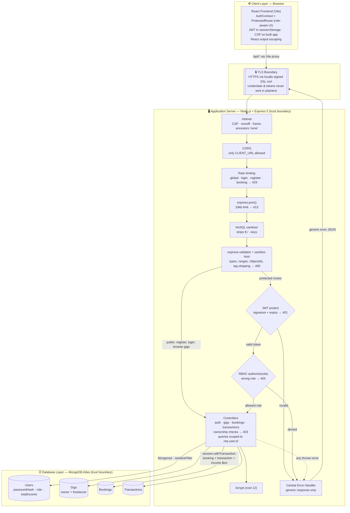
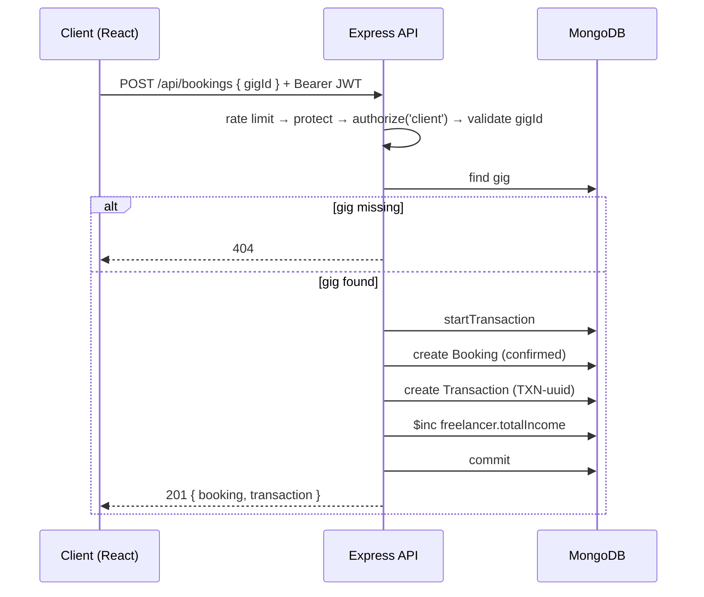

# HustleHub+ Architecture (Part 2 — Secure Stack)

This diagram shows the full MERN application as implemented in Part 2, with system boundaries and the security control applied at each stage a request passes through.

## Boundaries and security features shown

- **Browser** — the React app hides actions the user's role cannot perform (e.g. the Book button is only shown to clients) and route guards redirect users away from dashboards for other roles. This is a usability layer only; every rule is enforced again on the server.
- **TLS boundary** — all API traffic is HTTPS. In development the Vite proxy forwards `/api` to the HTTPS backend.
- **Application server** — the security perimeter. Requests pass, in order, through security headers, the CORS whitelist, rate limiting, a body-size limit, NoSQL operator stripping and schema validation before any business logic runs.
- **JWT gate → RBAC gate → ownership check** — three separate decisions: *who are you* (401), *is your role allowed* (403), and *is this resource yours* (403). All data queries are additionally scoped to the authenticated user's id.
- **Database** — Atlas is only reachable through Mongoose, with `sanitizeFilter` as a second layer against operator injection. Bookings, transactions and income updates are written atomically in one MongoDB transaction.
- **Errors** — every failure path ends in the central error handler, which never leaks stack traces or internals.

## Booking flow

